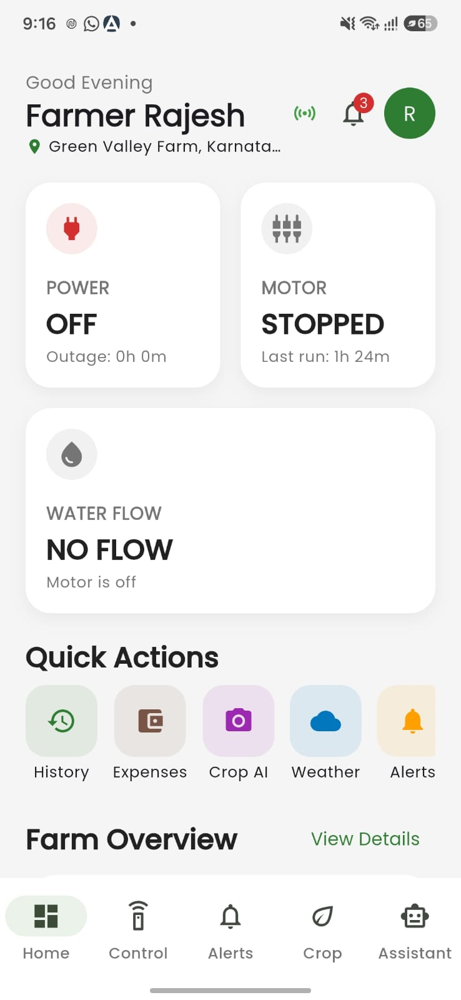
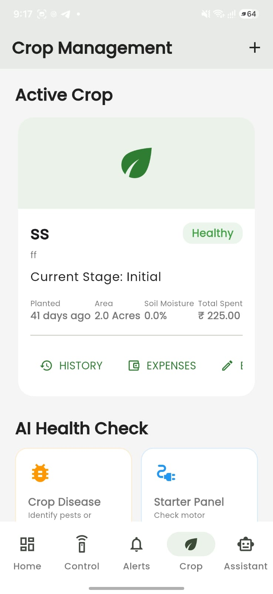
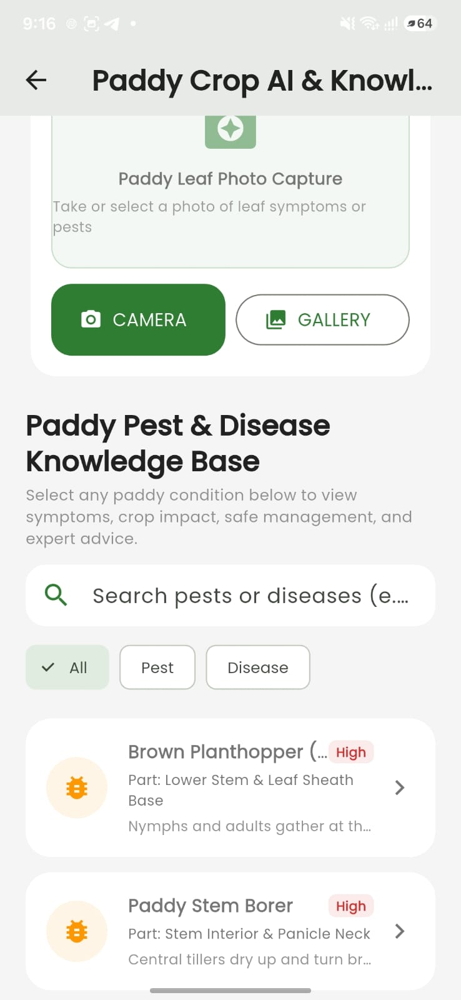
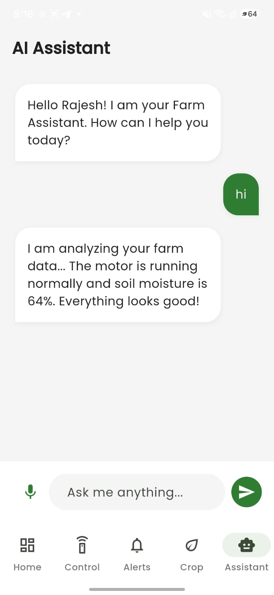
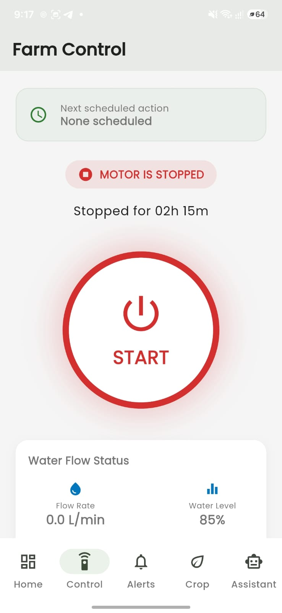
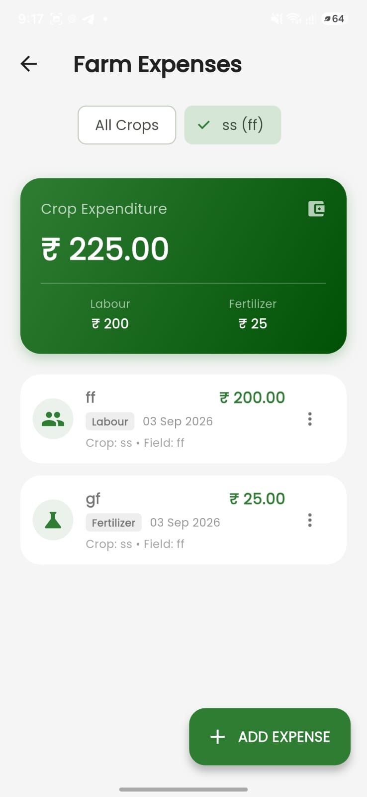

# Farmer Assistant AI 🌾

A Flutter-based Android application designed to help farmers manage
day-to-day farm information from one place. The app brings together farm
status, crop records, expense tracking, a conversational farmer
assistant, and paddy pest and disease reference information.

> **Project status:** Personal project. Screenshots show the implemented
> user interface; hardware connectivity, external API availability, and
> model performance depend on the local configuration and should be
> verified on the target device.

## Screenshots

### Home Dashboard


### Crop Management


### Paddy Crop AI & Knowledge Base


### AI Farmer Assistant


### Farm Control


### Farm Expenses


## Features

-   **Farm dashboard:** At-a-glance cards for power, motor, and
    water-flow status, plus shortcuts to common sections.
-   **Crop management:** View crop records and displayed details such as
    planting age, area, soil moisture, and total expenditure.
-   **Paddy pest and disease reference:** Search the knowledge base and
    filter entries by pests or diseases; open entries for symptoms, crop
    impact, and management guidance.
-   **Paddy photo workflow:** Use the camera or gallery to select a leaf
    image for the crop-AI workflow.
-   **Conversational farmer assistant:** Chat-style interface with voice
    input for asking farming-related questions.
-   **Farm control interface:** Motor start/stop controls, scheduling
    status, and water-flow information. Actual control of physical
    equipment requires compatible hardware and a configured connection.
-   **Expense tracking:** Record and review crop expenses, view category
    breakdowns, and see totals.
-   **Farm history and alerts:** Dedicated sections are available from
    the app navigation for reviewing farm activity and alerts.
-   **Localization settings:** The project includes app-language
    settings.

## Technology

-   **Mobile app:** Flutter and Dart
-   **On-device ML:** TensorFlow Lite model assets for the paddy crop AI
    workflow
-   **Local data:** SQLite is listed as part of the project stack;
    confirm the current implementation and data persistence behavior
    before relying on it
-   **Platform:** Android
-   **Project structure:** Screens, models, providers, services, theme,
    localization, and tests are organized under `lib/`

## Repository structure

``` text
farmer_assistant/
├── android/             # Android platform configuration
├── assets/
│   └── models/           # TensorFlow Lite model and labels
├── lib/
│   ├── localization/     # App localization
│   ├── models/           # Data models
│   ├── providers/        # App state and providers
│   ├── screens/          # Dashboard and feature screens
│   ├── services/         # Assistant, crop AI, farm, voice, and related services
│   ├── theme/            # App colors and theme
│   └── widgets/          # Reusable UI components
├── test/                 # Flutter tests
├── pubspec.yaml
└── README.md
```

## Run locally

### Prerequisites

-   Flutter SDK installed and configured
-   Android Studio or another supported Flutter development environment
-   An Android emulator or Android device with USB debugging enabled

### Steps

1.  Clone the repository:

    ``` bash
    git clone https://github.com/Somujavooru/farmer-assistant-ai.git
    cd farmer-assistant-ai
    ```

2.  Install dependencies:

    ``` bash
    flutter pub get
    ```

3.  Check the Flutter environment and connected devices:

    ``` bash
    flutter doctor
    flutter devices
    ```

4.  Run the app:

    ``` bash
    flutter run
    ```

5.  Run the available tests:

    ``` bash
    flutter test
    ```

## Configuration and safety notes

-   If you use the conversational assistant, configure its API key
    through the app's supported settings flow. **Do not commit API keys,
    private credentials, signing keys, or personal data to GitHub.**
-   A key embedded in a mobile app is not a secure secret: a production
    deployment should route privileged API requests through a protected
    backend or use a suitable restricted-key strategy.
-   Crop-AI predictions and reference information should be treated as
    decision support, not a substitute for local agricultural expertise
    or official crop-protection guidance.
-   Motor and sensor readings may be sample, simulated, or
    hardware-dependent unless the corresponding device integration is
    configured and verified.
-   Do not operate irrigation equipment remotely unless the hardware,
    electrical protections, network behavior, and emergency stop
    procedures have been tested.

## Testing

Run the tests included in the repository with:

``` bash
flutter test
```

Review the results before claiming test coverage or production
readiness. Manually verify key flows on a real device, including image
selection, unavailable network/API behavior, data persistence, and
motor-control behavior where compatible hardware is connected.

## Future improvements

-   Add clear offline and retry states for network-dependent features.
-   Improve model evaluation with a documented test dataset and
    per-class metrics.
-   Add automated widget and service tests for the main user flows.
-   Document supported sensors/controllers and their communication
    protocol.
-   Add a release workflow and publish a signed Android build when
    ready.

## Author

**Somashekhar Javooru**

-   GitHub: [Somujavooru](https://github.com/Somujavooru)
-   Repository:
    [farmer-assistant-ai](https://github.com/Somujavooru/farmer-assistant-ai)

------------------------------------------------------------------------

Built as a practical software project exploring mobile application
development and AI-assisted farming workflows.
